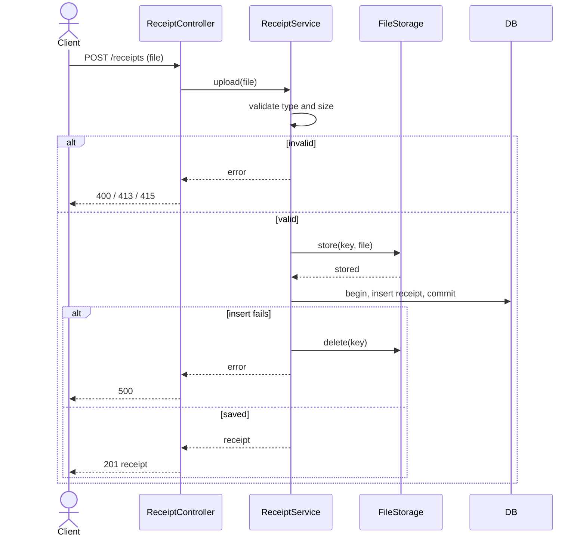
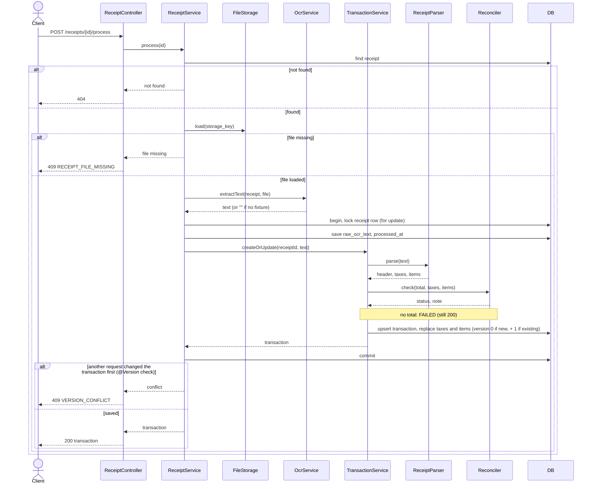
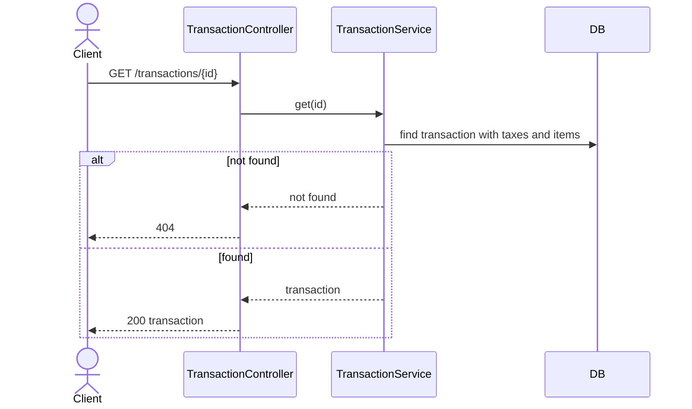
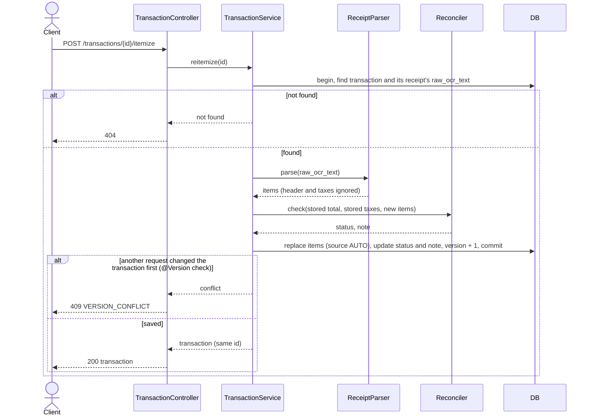
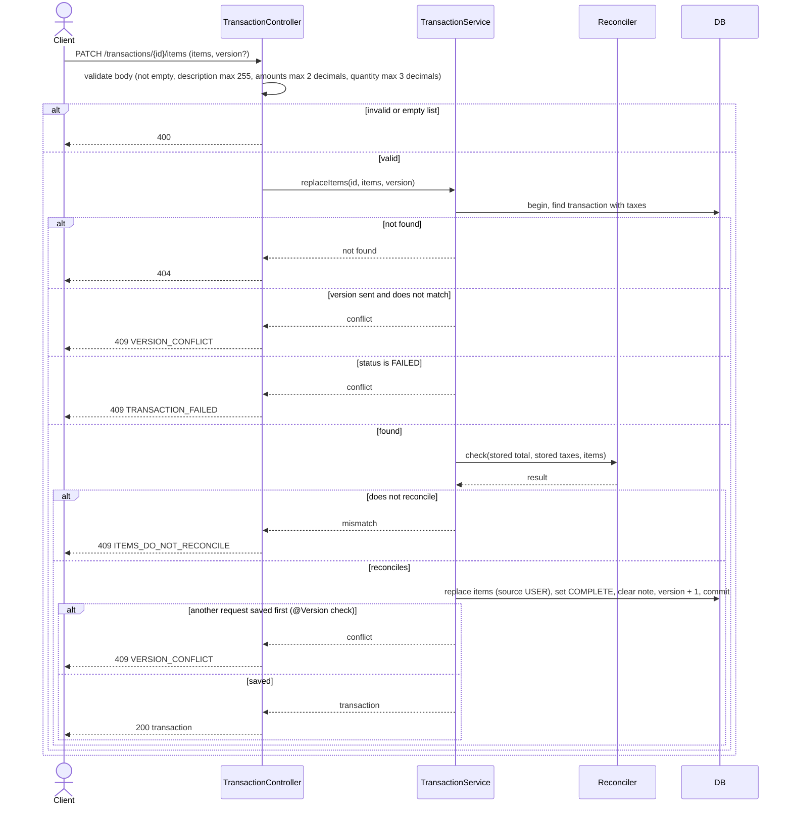
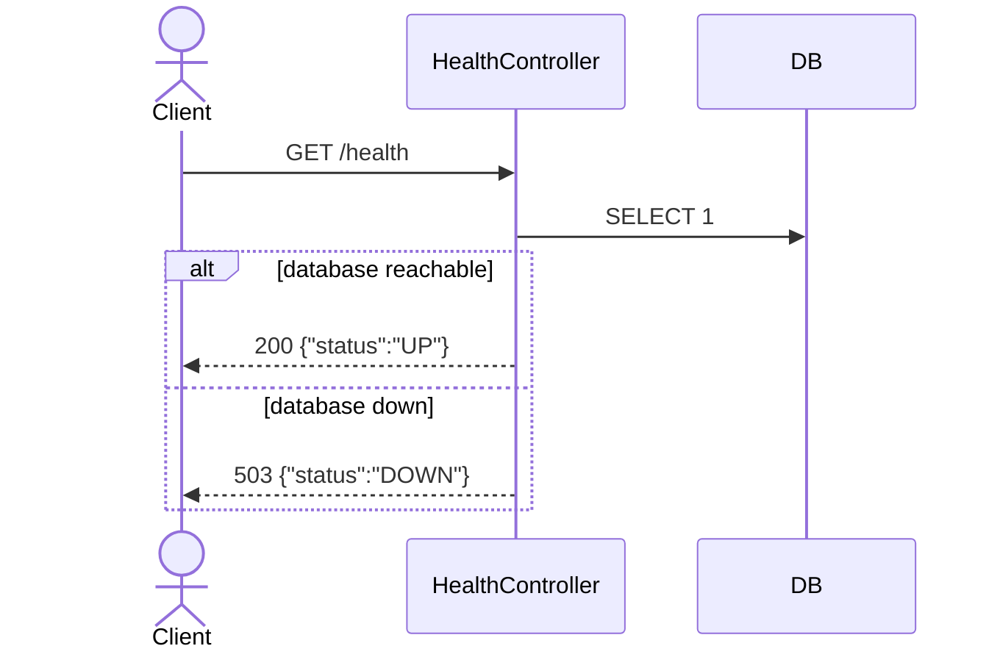

# Design diagrams

Sequence diagrams for each operation. `DB` is the SQL database; `Storage` is the file storage for the active profile.
Not-found and conflict cases are thrown by the service and turned into 404 / 409 by `GlobalExceptionHandler`.
Any write to a transaction can lose a race with another write; the `@Version` check turns that into 409 `VERSION_CONFLICT`.

## Upload receipt (`POST /receipts`)

The file is stored before the DB transaction, so a slow upload never holds a DB connection.

## Process receipt (`POST /receipts/{id}/process`)

OCR runs before the DB transaction. The receipt row is locked so two calls on the same receipt run one after the other.
Re-processing replaces all taxes and items, including items the user edited.

## Get transaction (`GET /transactions/{id}`)

## Re-itemize (`POST /transactions/{id}/itemize`)

Replaces all items, including items the user edited. Header and taxes are not changed.

## Replace items (`PATCH /transactions/{id}/items`)

Nothing is written unless the items reconcile. `version` is optional in the request; if sent, it must match.

## Health (`GET /health`)

